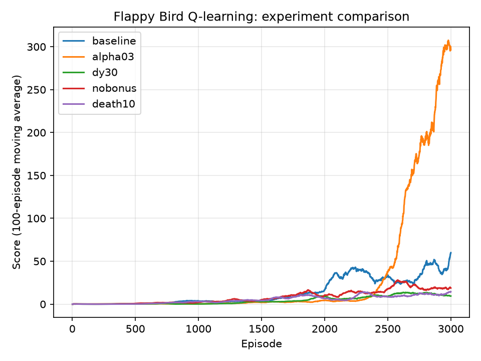
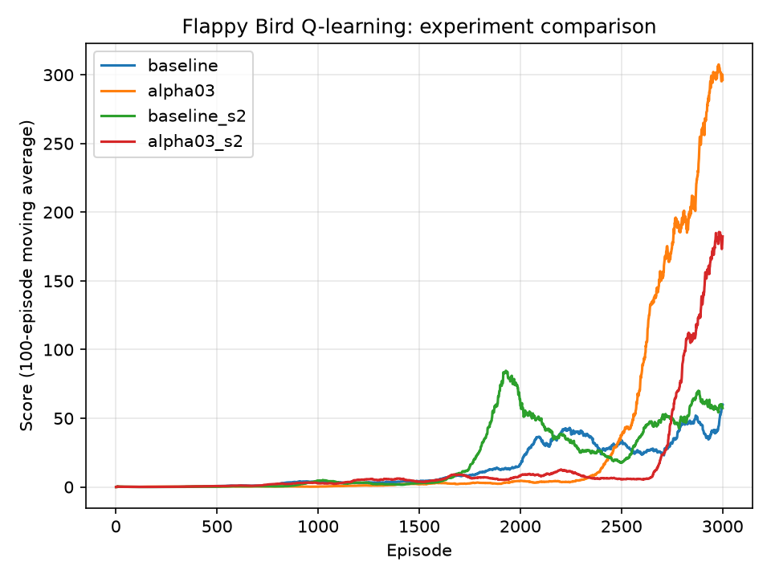

# Project03_RL: Teaching an AI to Play Flappy Bird with Q-Learning

Solomon Hornstein · ADV CS III: Machine Learning and AI · Mr. Cochran

An AI agent learns to play a Flappy Bird–style game from scratch using **tabular Q-learning**. The agent is never told the rules: it only sees three numbers describing its situation, chooses whether to flap, and receives rewards. Starting from random crashes, it learns to fly through hundreds of pipes in a row.

> AI use: much of this project's code and documentation was written with Claude (Anthropic's AI). See [AI_USAGE.md](AI_USAGE.md) for exactly what was AI-generated and what I did myself.

## Why Flappy Bird?

- **The rules are simple but the timing is hard.** One wrong flap ends the game, so the agent has to learn precise control.
- **The state can be small.** Three numbers describe everything that matters, which makes a Q-table practical and every design choice explainable.
- **Learning is easy to see.** An untrained agent crashes within seconds; a trained one survives for minutes. That contrast makes a clear demo.
- **It avoids the most common tutorial.** The suggested Snake tutorial is widely copied; building a custom environment meant the state and rewards had to be designed from scratch rather than copied.

## How to install and run

Requires Python 3. On Python 3.14, regular `pygame` fails to install, so this project uses **pygame-ce** (Community Edition), a drop-in replacement (`import pygame` still works).

```
pip install -r requirements.txt
```

| Command | What it does |
|---|---|
| `python flappy_env.py` | Play the game yourself (SPACE = flap) |
| `python train.py --watch` | Watch the trained agent (`q_table.pkl`) play with no exploration |
| `python train.py` | Train a new agent from scratch (overwrites `q_table.pkl`) |
| `python train.py --resume` | Continue training the saved agent |
| `python compare_runs.py` | Plot learning curves from `scores_*.csv` files |

**Keys while the game window is open:** `R` turns rendering on/off (off trains much faster), `UP`/`DOWN` change playback speed from 1x to 32x, `S` saves the Q-table, `ESC` quits (training runs save automatically).

**Experiment flags for `train.py`:** `--episodes`, `--alpha`, `--gamma`, `--dy-bucket`, `--pipe-bonus`, `--death-penalty`, `--seed` (makes runs reproducible), and `--name` (saves `scores_<name>.csv` and `q_table_<name>.pkl` so runs don't overwrite each other).

## The reinforcement learning design

### The agent-environment loop

The project separates the **environment** (`flappy_env.py`) from the **agent** (`agent.py`). The agent never reads the game's physics or collision code. Each frame:

1. The environment gives the agent the current **state**.
2. The agent chooses an **action**.
3. The environment advances one frame and returns a **reward**, the **next state**, and whether the game ended.
4. The agent updates its Q-table from that experience.

This is what "the game starts without knowing its rules" means: everything the agent knows, it learned from rewards.

### State

| Value | Meaning | Bucket size |
|---|---|---|
| `dx` | Horizontal distance to the far edge of the next pipe | 20 px (capped, so distant pipes all look alike) |
| `dy` | Bird's height relative to the center of the gap (+ = below) | 15 px (clamped at ±20 buckets) |
| `vel` | Vertical velocity (+ = falling) | 2 |

A Q-table needs a finite number of states, so the raw numbers are rounded into buckets. A training run typically visits a few thousand distinct states (shown as "States seen" in the stats panel). Bucket size is a tradeoff: smaller buckets give more precise information but more states to learn.

### Actions

Two actions: **0 = do nothing**, **1 = flap**.

### Rewards

| Event | Reward | Purpose |
|---|---|---|
| Each frame survived | +0.1 | Encourages staying alive |
| Passing a pipe | +5 | Rewards actual progress |
| Crashing | −100 | Strongly discourages crashing |

### Q-learning

The agent stores a Q-value for every (state, action) pair: its estimate of the total future reward from taking that action in that state. After each step it updates:

```
Q(s, a) ← Q(s, a) + α · [ reward + γ · max Q(s', a') − Q(s, a) ]
```

- **α (alpha) = 0.3**, the learning rate: how far each update moves the old estimate.
- **γ (gamma) = 0.95**, the discount: how much future rewards count. This is how the −100 crash penalty flows backward to the states that *led* to the crash, so the agent learns to avoid danger before it reaches it.

### Exploration (epsilon-greedy)

With probability ε the agent takes a random action; otherwise it takes the action with the highest Q-value. ε starts at **0.1** (not the usual 1.0) and decays each episode. In Flappy Bird, random flapping kills the bird almost immediately, so heavy exploration mostly teaches "you died." A small ε lets the agent survive long enough to discover useful situations.

## Experiments and results

I ran controlled experiments: each run used **3,000 episodes** and the same random **seed**, and changed **one setting** from the baseline (α = 0.7, dy bucket 15, pipe bonus +5, death penalty −100). Scores are shown as a 100-episode moving average.



| Run | Change from baseline | Final avg score | Best score | First episode avg ≥ 50 |
|---|---|---|---|---|
| baseline | none | 60.0 | 292 | 2808 |
| **alpha03** | **α 0.7 → 0.3** | **296.5** | **500** (cap) | **2559** |
| dy30 | dy bucket 15 → 30 | 9.4 | 67 | never |
| nobonus | pipe bonus +5 → 0 | 18.8 | 149 | never |
| death10 | death penalty −100 → −10 | 14.4 | 117 | never |

### Confirming the alpha result with a second seed

One seed can be a lucky fluke, so I reran the baseline and α = 0.3 with seed 2.



On both seeds, α = 0.3 finished far ahead of α = 0.7:

| Run | α | Seed | Final avg score | Best score | First episode avg ≥ 50 |
|---|---|---|---|---|---|
| baseline | 0.7 | 1 | 60.0 | 292 | 2808 |
| alpha03 | 0.3 | 1 | 296.5 | 500 (cap) | 2559 |
| baseline_s2 | 0.7 | 2 | 57.4 | 440 | 1859 |
| alpha03_s2 | 0.3 | 2 | 182.3 | 500 (cap) | 2746 |

### What the results show

**Learning rate is the main finding.** With α = 0.7, each update moves a Q-value 70% of the way toward the newest experience, so the table mostly reflects the last few episodes. That lets the agent improve early (on seed 2, the α = 0.7 run reached an average of 50 at episode 1,859, almost 900 episodes before the α = 0.3 run), but a single bad episode can overwrite much of what it learned. The curves show this: the seed-1 baseline rose to about 40 around episode 2,200 and then fell back, and `baseline_s2` climbed to about 85 near episode 1,950 before crashing to about 20. With α = 0.3, each update only moves 30% of the way, so a Q-value reflects an average over many experiences instead of the latest one. Both α = 0.3 runs stayed flat longer, but once they started improving they kept their gains and climbed far higher. This is the speed-vs.-stability tradeoff in reinforcement learning: a high learning rate adapts quickly but is noisy, and a lower one is slower but more reliable.

**Bigger buckets hurt (dy30).** With 30-pixel buckets, "just inside the edge of the gap" and "about to clip the pipe" often land in the same state, so the agent gets the same Q-values for situations that need different actions. Fewer states should be quicker to fill in, but that didn't help here: without precise information the agent can't learn precise control, and it had the lowest final score of all runs (9.4).

**Removing the pipe bonus slowed learning (nobonus).** Without the +5 bonus, the only positive reward is +0.1 per frame. Surviving is still rewarded, but the signal is weak and spread out, so the agent gets little extra credit for actually clearing a pipe. Learning progressed, but much more slowly (final average 18.8).

**A smaller death penalty also slowed learning (death10).** The −100 crash penalty is what flows backward through γ to warn the agent several frames before a collision. At −10, that warning is about the same size as the reward from surviving one or two seconds, so dangerous states don't look much worse than safe ones. The agent took much longer to learn to avoid them (final average 14.4).

**Caveats.**
- Most curves were still rising at episode 3,000, so "slower within 3,000 episodes" does not necessarily mean "worse" with longer training.
- The point where α = 0.3 took off varied by seed (around episode 2,400 for seed 1 and 2,700 for seed 2).
- Only the learning-rate result was checked on a second seed; the other three experiments ran on one seed each.
- Two seeds is evidence, not proof.

### Final design

Based on these results, the default learning rate is **α = 0.3**. The included `q_table.pkl` is the seed-1 α = 0.3 agent (final average ≈ 296).

## Files

| File | Purpose |
|---|---|
| `flappy_env.py` | The game environment: physics, pipes, collisions, rewards, `reset()`/`step()`, human-play mode |
| `agent.py` | The Q-learning agent: state discretization, epsilon-greedy policy, Q-update, save/load |
| `train.py` | Training/watch loop with live stats panel, learning graph, speed control, experiment flags |
| `compare_runs.py` | Plots experiment learning curves and prints the summary table |
| `q_table.pkl` | The trained agent used by `--watch` |
| `scores_*.csv` | Per-episode scores from each experiment |
| `learning_curves_experiments.png`, `learning_curves_seeds.png` | Result charts |
| `requirements.txt` | Dependencies: `pygame-ce`, `matplotlib` |
| `AI_USAGE.md` | Documentation of AI assistance (Honor Code) |

## Resources used

- Claude (Anthropic): code generation, design, debugging help, and documentation; see [AI_USAGE.md](AI_USAGE.md)
- pygame-ce documentation: https://pyga.me/docs/